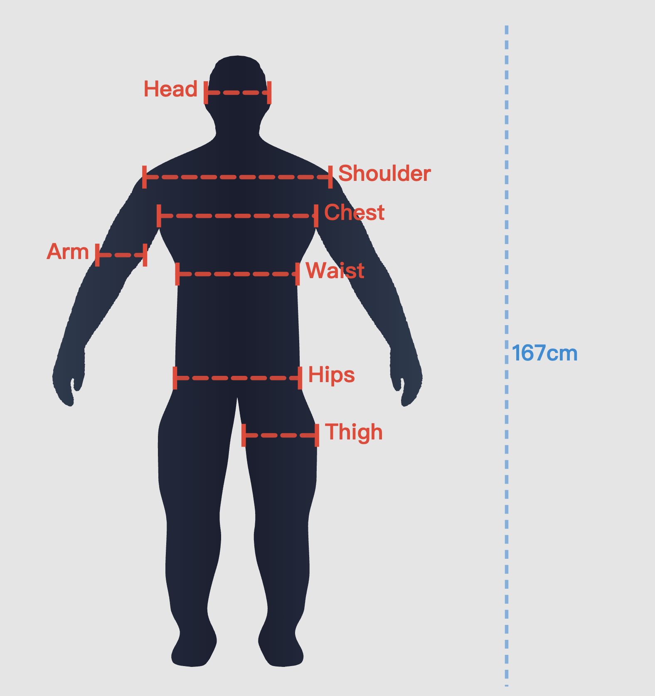
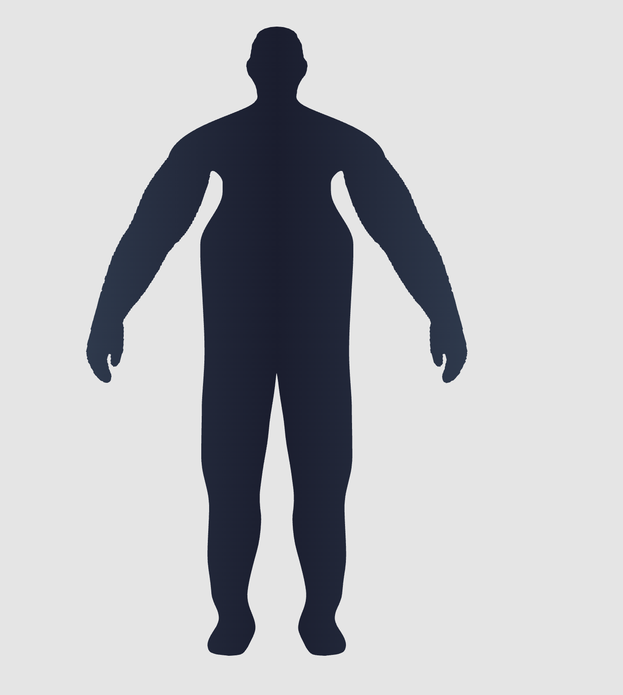

# BIA-InW Body Visualizer

A browser-based body image assessment for research and Qualtrics surveys. Participants adjust a silhouette to represent three bodies in sequence:

**Current Body → Ideal Body → Reasonable Body**

Each page has seven dimensions, arranged from top to bottom: **Head, Shoulder, Arm, Chest / Bust, Waist, Hips, and Thigh**. Sliders use integer settings from **1 to 100**, with randomized starting values from **5 to 95**. If all sliders remain at their initial values, participants must confirm that choice before continuing.

## v60: no height entry

The current release removes participant height entry and its validation requirement. Two display versions are available: with or without measurement guides. Both retain the same internal SVG measurement calculations for analysis. Starting and final SVG scores, starting and final slider settings, and visible time on each body page are retained.

## Two versions

| With dimension guides | Without dimension guides |
|---|---|
| Lines identify the seven measured dimensions. | The silhouette is displayed without those lines. |
| [Open with guides](https://yvikxu.github.io/bia-visualizer-task/body-visualizer.html) | [Open without guides](https://yvikxu.github.io/bia-visualizer-task/body-visualizer-noline.html) |
| `body-visualizer.html` | `body-visualizer-noline.html` |

<table><tr><td align="center" valign="bottom"><br>With dimension guides</td><td align="center" valign="bottom"><br>Without dimension guides</td></tr></table>

These examples use different body settings. The two app variants have identical controls, geometry, scoring and export logic; only the visible measurement guides differ. Neither version collects height. Existing app addresses are retained.

## Validation

The supplied v60 standalone file passed 71 offline form-flow checks, 2,100 slider-isolation checks, and 3,500 geometry configurations. All 24,500 measured dimension comparisons matched v58. The no-height Qualtrics adaptation also passed controlled save/restore, field mapping, completion gating, and message-origin checks. See [integration-checks.md](qualtrics/integration-checks.md) for the current verification scope. These checks do not establish psychological measurement validity.

## What does the measurement output?

The standalone app downloads a **CSV file**, a table you can open in Excel or statistical software. The current standalone export has **186 columns**, including body values and extra details about the session and calculations.

**You do not have to save everything in Qualtrics.** Choose the values your study needs. In Qualtrics, each Embedded Data field is a named space that stores a value with a survey response.

The supplied connection saves **87 body result fields**:

| What is saved | Fields across 3 bodies | Example | Purpose |
|---|---:|---|---|
| Final SVG scores | 21 | `cbs_wa_svg_score` | Scores calculated from the drawn dimension lengths |
| Starting SVG scores | 21 | `init_cbs_wa_svg_score` | The same scores before adjustment |
| Final slider settings | 21 | `cbs_wa` | Recreate the final figure |
| Starting slider settings | 21 | `init_cbs_wa` | Recreate the starting figure and original arm reference |
| Visible time, seconds | 3 | `cbs_duration_seconds` | Time looking, adjusting and waiting in a pop-up; time away is excluded |
| **Total** | **87** | **29 per body × 3** | |

**Reading the names:** `cbs` = Current Body; `ibs` = Ideal Body; `rbs` = Reasonable Body. `init_` means a starting value. Dimension names are `hd` (Head), `sh` (Shoulder), `ar` (Arm), `ch` (Chest), `wa` (Waist), `hi` (Hips), and `th` (Thigh).

Other standalone outputs include measured drawing-line lengths (`svg_measure`), the difference between SVG score and slider (`svg_delta`), unchanged-body confirmations, and session/export details. These are not part of this 87-field selection.

### Why are the SVG score and slider setting different?

**Slider setting → body drawing → measured dimension length → SVG score**

We adjusted the body shapes to keep the silhouette looking natural and human-like. Moving a slider by the same amount therefore does not necessarily produce an equal change in a drawn dimension's length. Do not treat its 1–100 setting as a direct measure of that length.

The app measures the relevant line across the silhouette and converts its length to a **1–100 SVG score**, using that dimension's reference minimum and maximum. This conversion is linear in the measured length. Use the SVG score for the length-based value and the slider setting to recreate the figure. Keep the SVG score's decimal places.

This does not mean every slider is strongly nonlinear: current checks found several dimensions linear within numerical precision, while Head and Arm remain approximately linear. Measuring the drawing avoids assuming that its score equals the slider setting. Drawing lengths are not body circumferences or real-world measurements in centimeters.

## How to embed it in Qualtrics

All setup files are together in the **[qualtrics/](qualtrics/)** folder. The two full apps stay in the project's main folder.

### Updating an existing survey

Keep the existing iframe address. Replace the question JavaScript with [qualtrics/question.js](qualtrics/question.js), use the 87-field result list, test a new response, and publish the survey changes. Updating GitHub does not update JavaScript previously pasted into Qualtrics. Height-enabled saved states are not silently converted or overwritten; validate this release with a new response.

### 1. Put your own copy online

Keep your own copy so you control when the measurement changes.

1. Sign in to GitHub. On this project's page, click **Fork** to create a copy in your account.
2. In your copy, open **Settings → Pages**. Choose **Deploy from a branch**, **main**, and **/ (root)**, then save.
3. Wait until GitHub shows that your site is ready. Open the file link for your chosen version:

```text
With dimension guides (no height):
https://YOUR-NAME.github.io/YOUR-REPO/body-visualizer.html

Without dimension guides (no height):
https://YOUR-NAME.github.io/YOUR-REPO/body-visualizer-noline.html
```

Replace `YOUR-NAME` and `YOUR-REPO` with your own names. Participants do not need a GitHub account.

**Leave your copy unchanged while collecting data.** Updates to the original project will not change your copy unless you choose to bring them in. Updating your own Pages file changes every survey using that address, even without republishing Qualtrics. Test updates separately first.

### 2. Choose the values to save

For the supplied setup, open **Survey Flow** and add an **Embedded Data** element **before the assessment block**. Add every name in [qualtrics/all-fields.txt](qualtrics/all-fields.txt), leaving the initial values blank. Do not set these fields back to blank later in the flow.

The list contains:

- **87 result fields**, listed separately in [embedded-data-fields.txt](qualtrics/embedded-data-fields.txt).
- **2 technical fields**, `bia_state` and `bia_complete`, listed in [recovery-fields.txt](qualtrics/recovery-fields.txt). These preserve progress and completion; they are not additional body measurements.

You may choose a different set of results for your study. The app's outgoing values and the question connection's list must be changed together. **Creating extra Qualtrics fields alone does not make the app send those values.** See [setup.md](qualtrics/setup.md) for the places to change, or ask the person helping you with the code. Keep the recovery information even if you select fewer analysis fields.

### 3. Add the app to a survey page

1. Add a **Text / Graphic** question to your assessment block. Put it on its own survey page.
2. Open the question's **HTML/source view**. Replace its contents with [qualtrics/question.html](qualtrics/question.html).
3. In `data-app-url`, replace the example address with your own full app link from Step 1.

**Want guides?** Use the link ending in `/body-visualizer.html`.

**Want no guides?** Use the link ending in `/body-visualizer-noline.html`.

Keep the response and survey identifier placeholders in the HTML unchanged. Do not paste the whole app into Qualtrics. The short HTML displays the online app inside the question.

### 4. Connect it to the survey

Open **JavaScript** for that question. Replace the editor's contents with all of [qualtrics/question.js](qualtrics/question.js), then save.

The connection reads the app address from your question. It accepts messages only from that app's frame and site, saves the chosen results, and hides Qualtrics Next while the assessment is unfinished. Once all three bodies pass validation and the survey page accepts the results, **Qualtrics Next appears**. The participant clicks it to save the page and continue.

If JavaScript is unavailable in your account, ask your Qualtrics administrator whether your license allows it. See the [official JavaScript instructions](https://www.qualtrics.com/support/survey-platform/survey-module/question-options/add-javascript/).

### 5. Understand saving and returning

The app passes progress to the survey during the task. A browser copy is tied to the existing Qualtrics response identifier, so a different response does not reuse the same person's figure. Initial values, adjusted figures, original arm reference, current page, confirmations and visible time are preserved.

**The completion message confirms that the survey page accepted the values. Clicking Qualtrics Next saves that page to Qualtrics' server.** Before that click, recovery of an unfinished draft depends on storage in the same browser. Clearing browser data or unavailable browser storage can prevent recovery. Unsubmitted cross-device recovery is not supported.

The apps run on GitHub Pages, but responses are not uploaded to GitHub. Results are passed to Qualtrics and cached in the survey site's browser storage.

### 6. Check your setup before collecting data

Use **Preview** first. Check [test-checklist.md](qualtrics/test-checklist.md), then complete a test response and inspect its exported values.

Confirm height is absent on all three pages. Check unchanged-body confirmation, completion, refresh/return behavior, separate responses, and the devices you allow. Seeing the figure appear does not prove the results were saved. Only publish the survey when your setup has passed these checks.

### Desktop and phone layout

The embedded survey page uses a wider window. Each dimension name sits beside its slider to keep the controls compact. At widths of 600 pixels or more, the figure is on the **left** and controls on the **right**. On narrow portrait screens, the figure stays above a separate scrolling control panel, so it cannot cover the sliders. Landscape phones use a smaller figure panel. Very small screens or larger text may still require scrolling within the controls. A webpage cannot reliably force a phone to rotate.

Desktop Chrome block Preview has been checked for v60. Published-response data verification and simulated portrait/landscape checks for the earlier height-enabled release are documented separately; they were not repeated for v60. **A systematic real-phone touch and loading test is still needed before mobile data collection.**

## Troubleshooting

| Problem | First thing to check |
|---|---|
| The app does not appear. | Open its full link by itself. Check the filename, Pages deployment and `data-app-url`. |
| The wrong version appears. | Check whether the link ends in `body-visualizer.html` or `body-visualizer-noline.html`. |
| Values are blank. | Check the question JavaScript and matching field names, defined before the block. |
| Next does not appear. | Check unchanged-body confirmation on all three pages, then read the save status above the app. |
| A return creates a new random figure. | Check that it is the same survey response and that browser storage is available. Stop collection until recovery works as documented. |
| New code is not visible in the live survey. | Qualtrics draft changes require Publish; Pages changes require a successful deployment. Test the draft before publishing. |

Current v60 verification details are recorded in [qualtrics/integration-checks.md](qualtrics/integration-checks.md). Earlier height-enabled live-survey results are historical and do not validate the v60 update.
